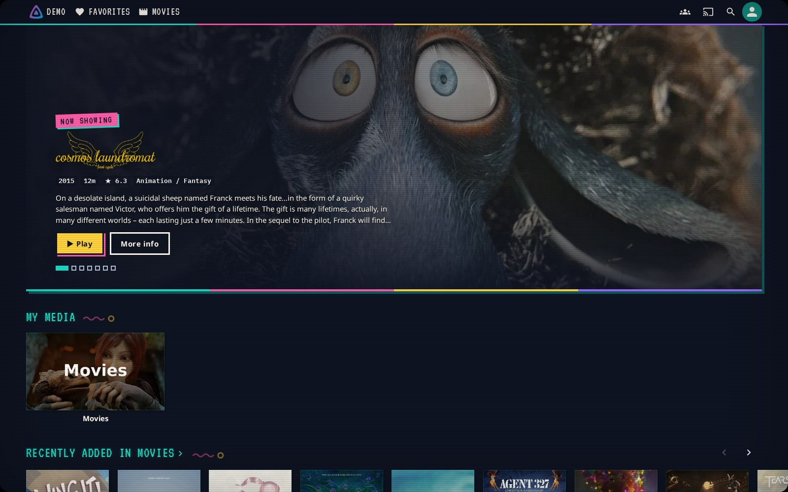
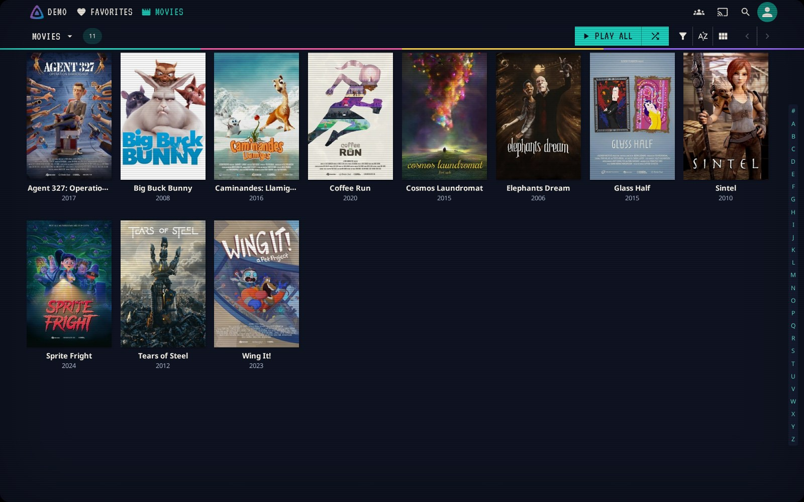
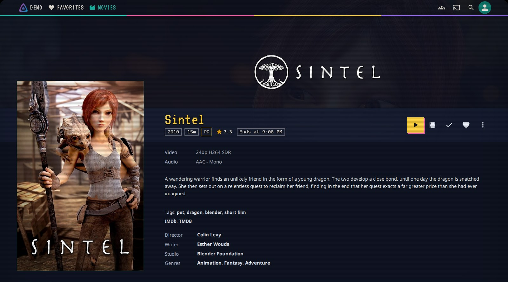
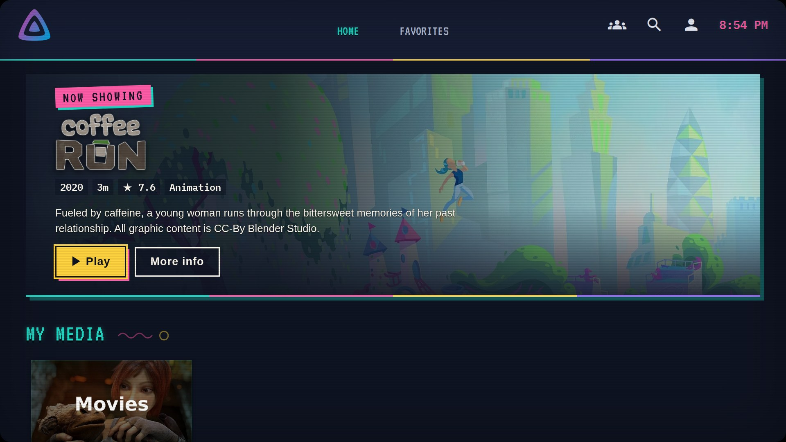
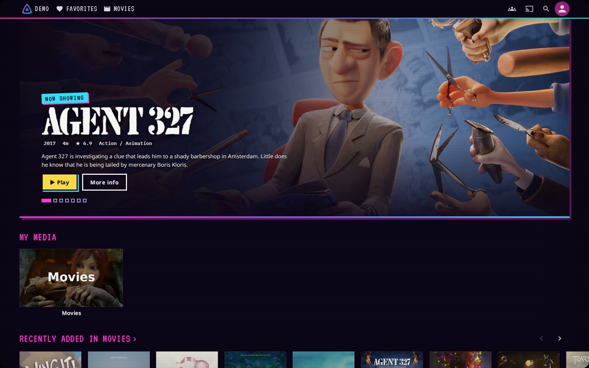
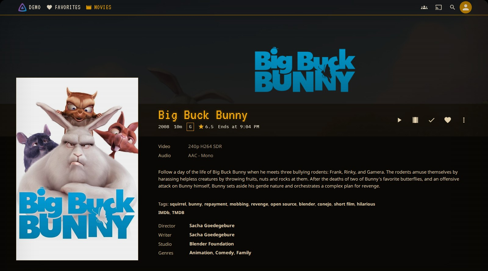

<p align="center">
  
</p>

# Retro 90s for Jellyfin

A Good Boy Rick Labs project.

**Made for Jellyfin 12.** Tested on Jellyfin 12.0.0. It uses color settings that were
introduced in Jellyfin 12, so it is not expected to work on Jellyfin 10.

A theme for the Jellyfin web client with a bright early-90s look: teal, hot pink, yellow
and purple on navy, pixel-font titles, a "Now Showing" banner on the home tab, and an
optional CRT scanline layer. It is built from separate layers, so you can use as much or as
little of it as you like.

This is an unofficial hobby project. It is not affiliated with or endorsed by Jellyfin.



| | |
|---|---|
|  |  |
|  |  |

The Amber palette:



The screenshots use a demo library of open movies by the Blender Foundation and Blender
Studio. See [THIRD-PARTY.md](THIRD-PARTY.md).

## What is in it

Every part is a separate file. Only `retro.css` is required.

| File | What it adds |
|---|---|
| `retro.css` | The base: pixel-font (VT323) titles, square corners, clear focus styles for TV remotes, larger text in the TV layout, Live TV guide colors, and the Amber palette. |
| `retro-memphis.css` | The Memphis palette: teal, hot pink, yellow and purple on navy. |
| `retro-arcade.css` | The Arcade palette: magenta and cyan on deep indigo. Use one palette file, or none for Amber. |
| `retro-memphis-shapes.css` | Small geometric shapes beside section titles. Needs the Memphis palette. |
| `retro-banner.css` and `now-showing.js` | The "Now Showing" banner at the top of the home tab. It rotates through items you can resume and recently added movies and shows. |
| `retro-crt.css` | Scanlines, a soft vignette, rounded screen corners and a glow on titles. It is removed while a video plays. |

## Compatibility

What was tested, and how:

| What | Status |
|---|---|
| Jellyfin 12.0.0, official `jellyfin/jellyfin:12.0` Docker image | Tested. In daily use on the author's server since October 2026. |
| Desktop layout in Chromium 136 | Tested with an automated browser on 2026-11-15: all layers load, both fonts load, no errors in the browser console. |
| TV layout | Tested with an automated browser using an LG webOS user agent. In October 2026 the same rules were also loaded in a real Chromium 68 build, the browser generation of LG webOS 5 TVs: every rule was accepted except `scrollbar-color`, which that browser ignores. |
| Video playback | Tested in October 2026 in the desktop and TV layouts: the CRT layer and the banner disappear while a video plays and return afterwards. |
| Other Jellyfin versions (10.x, 12.1 and later) | Not tested. The theme relies on Jellyfin 12's color variables, so older versions are unlikely to work. |
| Jellyfin installed without Docker, or with a different Docker image | Not tested. See "Manual install". |
| Phones, and the mobile layout | Not tested. |

Custom CSS only applies to clients that are built on Jellyfin's web client. Jellyfin 12.0
does not apply it to the admin dashboard.

## Install

There are two ways to install the theme. The first gives you everything. The second is
quicker but has no "Now Showing" banner, because the banner needs a script and Jellyfin's
Custom CSS box can only load styles.

### Option 1: Docker, files served by your own Jellyfin (everything)

This uses a small wrapper script as the container's entrypoint. Each time the container
starts, the script copies the theme files into Jellyfin's web folder inside the container,
adds the banner's script tag to `index.html`, and then starts Jellyfin as usual. Nothing
outside the container is changed. If anything goes wrong it logs one line and Jellyfin
starts without the theme.

1. Download this repository to the machine that runs Docker, for example to
   `/opt/jellyfin-retro-90s`.
2. In your `docker-compose.yml`, add one volume and one entrypoint line to the Jellyfin
   service (a full example is in `install/docker/docker-compose.example.yml`):

   ```yaml
       entrypoint: ["/retro-90s/install/docker/entrypoint.sh"]
       volumes:
         - /opt/jellyfin-retro-90s:/retro-90s:ro
   ```

3. Recreate the container: `docker compose up -d jellyfin`. The log should show:

   ```
   [retro-90s] theme files copied to /jellyfin/jellyfin-web/ui/retro
   [retro-90s] Now Showing script added to index.html
   ```

4. In Jellyfin, open Dashboard, then Branding (in some versions the box is under General),
   and paste this into **Custom CSS code**:

   ```css
   @import url('/web/ui/retro/retro.css?v=1.2.0');
   @import url('/web/ui/retro/retro-memphis.css?v=1.2.0');
   @import url('/web/ui/retro/retro-memphis-shapes.css?v=1.2.0');
   @import url('/web/ui/retro/retro-banner.css?v=1.2.0');
   @import url('/web/ui/retro/retro-crt.css?v=1.2.0');
   ```

5. Save, then reload the page in your browser. On a TV, close and reopen the Jellyfin app.

Notes:

- The wrapper was tested with the official `jellyfin/jellyfin:12.0` image running as the
  default (root) user inside the container. If the container runs as another user, the
  script cannot write to the web folder. It then logs
  `could not write to /jellyfin/jellyfin-web` and Jellyfin starts without the theme (tested).
- Starting the container again is safe: the files are copied again and the script tag stays
  single (tested).
- If your Jellyfin uses a base URL, put it in front of `/web/` in the import lines. This
  was not tested.

### Option 2: Custom CSS only, files loaded from a CDN (no banner)

Paste this into **Custom CSS code** instead. Nothing has to be installed on the server.

```css
@import url('https://cdn.jsdelivr.net/gh/lamou1nr/jellyfin-retro-90s@v1.2.0/theme/retro.css');
@import url('https://cdn.jsdelivr.net/gh/lamou1nr/jellyfin-retro-90s@v1.2.0/theme/retro-memphis.css');
@import url('https://cdn.jsdelivr.net/gh/lamou1nr/jellyfin-retro-90s@v1.2.0/theme/retro-memphis-shapes.css');
@import url('https://cdn.jsdelivr.net/gh/lamou1nr/jellyfin-retro-90s@v1.2.0/theme/retro-crt.css');
```

Things to know:

- Every browser that opens your Jellyfin will fetch the styles and fonts from jsDelivr, a
  public CDN. With Option 1 nothing is fetched from outside your server.
- Loading the theme from a different address than Jellyfin's own was tested with a local
  server. The jsDelivr addresses above have not been tested yet.

### Manual install (not tested)

If you run Jellyfin without Docker, the same result should be possible by hand: copy the
contents of `theme/` to a folder named `ui/retro` inside Jellyfin's web folder, and add
`<script src="ui/retro/now-showing.js"></script>` just before `</body>` in that folder's
`index.html`. A Jellyfin update will replace the web folder, so this has to be repeated
after each update. This path has not been tested.

## Choosing layers and palettes

Each line in Custom CSS can be removed on its own. Keep the order shown above: base first,
then one palette, then shapes, banner and CRT.

- **Arcade palette:** replace the `retro-memphis.css` line with `retro-arcade.css` and
  remove the shapes line.
- **Amber palette:** remove the palette line and the shapes line.
- **No scanlines:** remove the `retro-crt.css` line.
- **No banner:** remove the `retro-banner.css` line. The script stays installed but does
  nothing without that line.

## Adjusting it

Add your own rules after the import lines in Custom CSS. For example, to make the scanlines
fainter and the screen corners square:

```css
html:root { --retro-scan-dark: rgba(0, 0, 0, 0.07); --retro-corner: 0px; }
```

The color tokens at the top of `retro.css` (`--retro-accent`, `--retro-bg`, `--retro-ink`
and so on) can be overridden the same way. The two palette files are examples of that.

## How the banner works

`now-showing.js` runs in the browser of whoever is signed in. It asks your own Jellyfin
server for that user's resume list and recently added movies and shows, using the session
the web client already has, and shows up to seven of them with their backdrop and logo
artwork. It sends nothing to any other server. Play opens the item's page and presses its
own Play button, so playback goes through Jellyfin's normal path.

The script is written in an older style of JavaScript on purpose, so that it also runs on
the browser inside LG webOS 5 TVs.

## Uninstall

- Remove the import lines from Custom CSS. The look returns to normal at once.
- For Option 1, also remove the entrypoint line and the volume from `docker-compose.yml`
  and recreate the container. The copied files and the script tag live only inside the
  container, so they are gone with it.

## Credits

Retro 90s is written by Neil Lamoureux and published as a Good Boy Rick Labs project. The
logo at the top of this page is a drawing of Ricky, the author's dog. It is not part of the
theme and never appears in Jellyfin.

Fonts: VT323 and IBM Plex Mono, under the SIL Open Font License. Details and screenshot
credits are in [THIRD-PARTY.md](THIRD-PARTY.md).

## License

The theme is under the MIT license. See [LICENSE](LICENSE). The fonts in `theme/fonts/` keep
their own license, the SIL Open Font License 1.1.

### Logo and name

The Ricky logo (`docs/good-boy-rick-labs.png`) and the name Good Boy Rick Labs are not
covered by the MIT license. You may keep and show them when you copy or share this project.
You may not use them for any other project or product.
